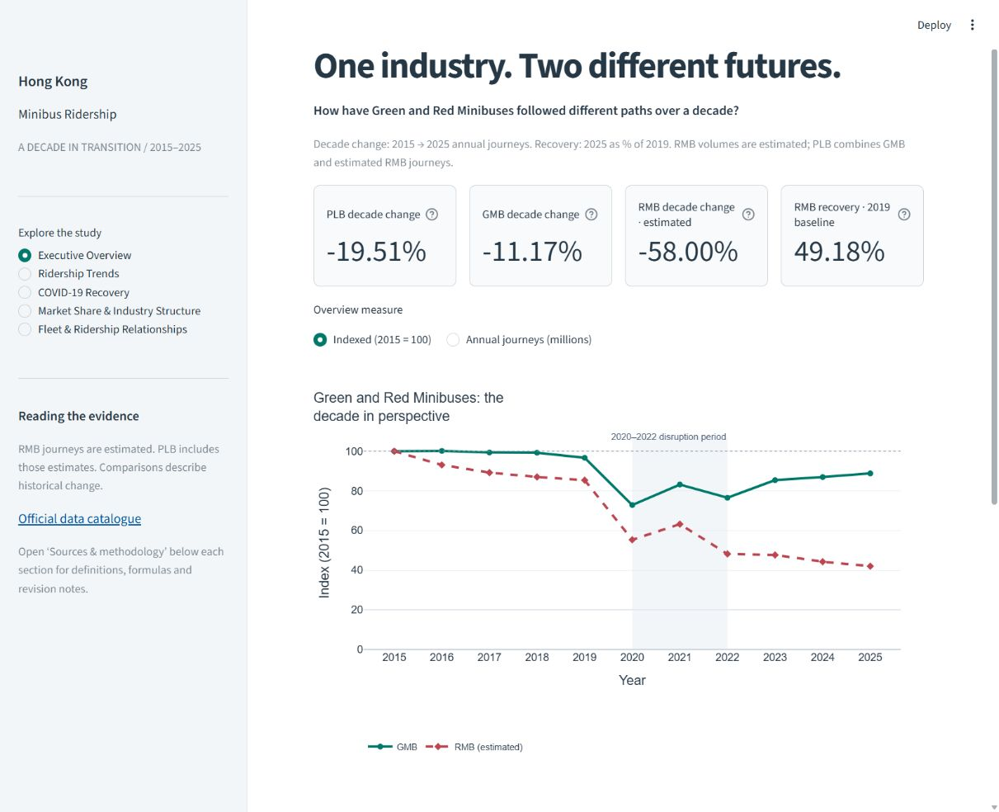
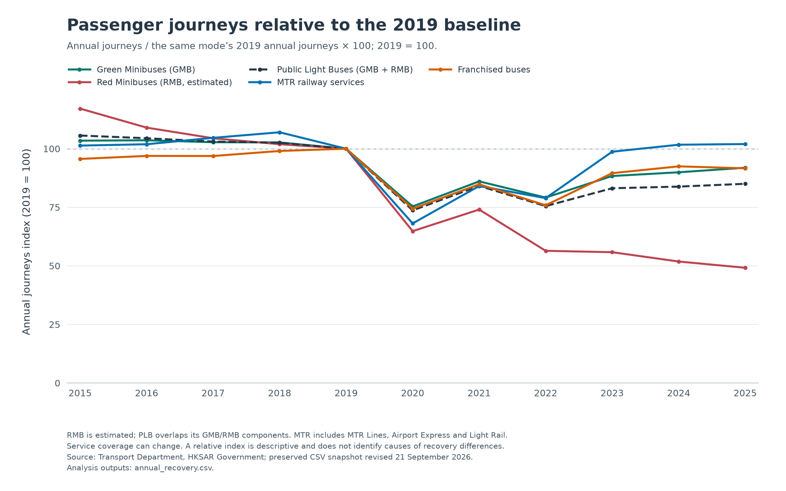
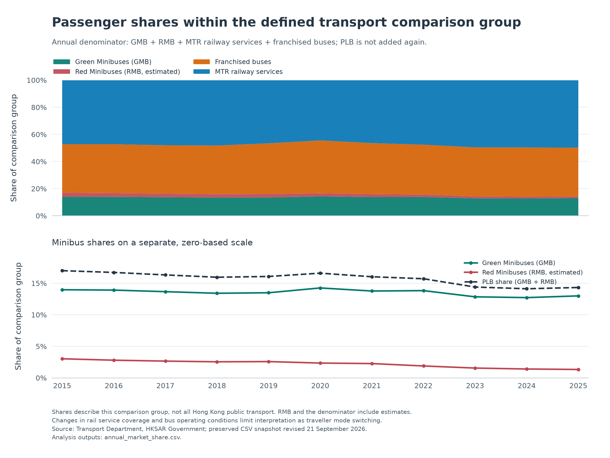

# Hong Kong Minibus Ridership: A Decade in Transition

**One Industry, Two Different Futures.** A historical transport analytics study, 2015–2025.

Hong Kong's Green and Red Minibuses share an industry headline but follow different passenger-demand trajectories. This project examines eleven complete years of official transport statistics to distinguish long-term change, disruption-period patterns and subsequent recovery, with MTR railway services and franchised buses as comparators.

The study connects source verification, Python preparation, a constrained SQLite model, independent SQL/Pandas calculations and an interactive dashboard. It shows why transport planning and industry discussion benefit from examining the two minibus categories separately. Findings describe published aggregate journeys; Red Minibus (RMB) volumes are estimates.

## Research questions

- How did Green Minibus (GMB), RMB and combined Public Light Bus (PLB) journeys change over the decade?
- Did the categories differ before, during and after 2020–2022, and how far did demand recover against pre-pandemic benchmarks?
- How did minibus composition and passenger shares within a defined transport comparison group change?
- What do calendar-month patterns and licensed fleet stock add to the historical picture?

The [research plan](docs/project_plan.md) specifies seven questions and their interpretation limits.

## Five findings

| Finding | Verified evidence |
| --- | --- |
| **The industry total was lower in 2025.** | Annual PLB journeys changed **−19.51%**, from **679.001 million** in 2015 to **546.545 million** in 2025. |
| **Green and Red Minibuses followed different paths.** | GMB annual journeys changed **−11.17%**, while estimated RMB journeys changed **−58.00%** between 2015 and 2025. |
| **RMB remained well below its 2019 benchmark.** | Its 2025 annual journeys were **49.18%** of its 2019 level; GMB reached **91.88%** of its own benchmark. |
| **GMB accounted for more of minibus patronage.** | GMB represented **90.72%** of PLB journeys in 2025, compared with **82.21%** in 2015. |
| **PLB's comparison-group share was smaller.** | Its share changed from **16.99% to 14.32%**, a reduction of **2.67 percentage points**, within PLB + MTR railway services + franchised buses. |

These claims trace to the unrounded [endpoint table](analysis/outputs/endpoint_comparison.csv), [minibus composition](analysis/outputs/annual_minibus_composition.csv) and [comparison-group shares](analysis/outputs/annual_market_share.csv). Read the [findings report](reports/eda_findings.md) for subperiods, alternative benchmarks and fleet context. These comparisons do not establish causes or individual passenger switching.

## Dashboard preview



*Actual application capture. Each mode's annual index uses its own 2015 total; shading marks 2020–2022. RMB is estimated. Five sections explore the overview, trends, recovery, shares and fleet context.*

<details>
<summary>Explore three research figures</summary>


*Complete-year totals show both scale and direction. PLB is GMB + RMB, so these are overlapping series.*



*Recovery uses each mode's full-year 2019 journey total. A value above 100 exceeds that benchmark.*



*The denominator is GMB + RMB + MTR railway services + franchised buses. The separate minibus panel uses a zero-based scale; PLB is not counted twice.*

</details>

All previews use the verified research outputs. **Data source: Transport Department, HKSAR Government, via DATA.GOV.HK.** Government and relevant rights holders retain intellectual property rights in source data. [Reuse terms](https://data.gov.hk/en/terms-and-conditions), [asset provenance](assets/README.md).

## Stack and analytical workflow

**Python 3.12 · pandas · SQLite/SQL · Matplotlib · Streamlit · Plotly · pytest**

1. **Verify sources:** preserve official CSV bytes and record coverage, revision dates, schemas and SHA-256 hashes.
2. **Prepare:** parse dates and status flags, map service components, retain RMB estimation metadata and build separate monthly-total, daily-rate and fleet tables with lineage.
3. **Validate:** check keys, coverage, units, calendar reconciliation, aggregation identities and annual publication discrepancies before replacing outputs.
4. **Analyze:** calculate complete-year trends, growth, composition, recovery and fleet proxies; cross-check six independent SQL queries against Pandas.
5. **Present:** generate seven research figures and a five-section dashboard that reads the included analytical tables.

The [cleaning methodology](docs/cleaning_methodology.md), [data dictionary](docs/data_dictionary.md), [analytical methods](docs/analysis_methodology.md) and [SQL examples using CTEs and window functions](sql/analysis/README.md) explain the implementation. The [portfolio validation record](docs/portfolio_validation.md) and [fresh-environment reproduction check](docs/reproducibility_check.md) document quality assurance.

## Official data

Publisher: **Transport Department, Government of the Hong Kong Special Administrative Region**, through the [Monthly Traffic and Transport Digest catalogue on DATA.GOV.HK](https://data.gov.hk/en-data/dataset/hk-td-tis_17-monthly-traffic-and-transport-digest-csv).

| Resource | Measurement |
| --- | --- |
| [Table 2.1](https://www.td.gov.hk/datagovhk_tis/mttd-csv/en/table21_eng.csv) | Monthly passenger journeys, thousands |
| [Table 2.1S](https://www.td.gov.hk/datagovhk_tis/mttd-csv/en/table21s_eng.csv) | Average daily passenger journeys, thousands per day |
| [Table 2.2](https://www.td.gov.hk/datagovhk_tis/mttd-csv/en/table22_eng.csv) | Month-end licensed minibus vehicles/capacity and available mileage |

The preserved snapshot was retrieved **11 October 2026**, with official revision date **21 September 2026**. Source coverage is January 2013–July 2026; analysis consistently selects **January 2015–December 2025: 132 months and 11 complete years**. Annual digest publications are separate validation references, rather than replacement observations. [Inventory, reference URLs and checksums](docs/data_sources.md).

## Project structure

```text
├── dashboard/app.py          # Streamlit entry point
├── src/hk_minibus/           # Preparation, analysis, figures and dashboard modules
├── scripts/                  # Preparation and analytical runners
├── sql/                      # SQLite schema/views and six analytical queries
├── config/                   # Fixed snapshot manifest and annual reference values
├── data/raw/                 # Four official CSVs; specification PDF stays local
├── data/processed/           # Validated CSVs, SQLite database and quality records
├── analysis/outputs/         # Analytical tables, SQL exports and check summary
├── analysis/figures/         # Seven reproducible research PNGs
├── reports/                  # Findings and publication-vintage investigation
├── docs/                     # Definitions, provenance, validation and release guide
├── assets/                   # Genuine dashboard preview and selected figures
└── tests/                    # Preparation, SQL parity, metrics, charts and app tests
```

Root files include pinned `requirements.txt`, `pyproject.toml`, `LICENSE`, `THIRD_PARTY_NOTICES.md` and `.gitignore`; `.streamlit/config.toml` sets the dashboard theme. Included outputs let reviewers run the dashboard immediately.

## Run locally

**Python 3.12 is the verified runtime.** Run from the repository root:

```bash
python -m venv .venv
```

Activate with `source .venv/bin/activate` on macOS/Linux or `.\.venv\Scripts\Activate.ps1` in Windows PowerShell. Then:

```bash
python -m pip install -r requirements.txt
python -m streamlit run dashboard/app.py
```

Open [localhost:8501](http://localhost:8501). If PowerShell activation is restricted, replace `python` with `.\.venv\Scripts\python.exe`. [Dashboard controls and metric definitions](docs/dashboard.md).

## Reproduce and test

**Before full reproduction or the complete test suite after cloning**, download the official specification PDF and verify its pinned SHA-256 using [these exact instructions](docs/data_reuse.md#download-the-dictionary-for-full-local-reproduction). It is retained locally but excluded from Git publication because redistribution permission is unresolved. The dashboard uses the included analytical outputs without this download; the pipelines and their tests verify all five original source files.

With that prerequisite satisfied:

```bash
python scripts/prepare_data.py
python scripts/analyze_data.py
```

The analytical runner executes all six SQL queries and checks their results against Pandas. For independent read-only query inspection, see [the SQL run instructions](sql/analysis/README.md). Run the complete software suite separately:

```bash
python -m pytest -q --basetemp analysis/.pytest-tmp-review -p no:cacheprovider
```

The named test directory is disposable; pytest replaces it. A fresh Windows/Python 3.12 environment reproduced the CSVs, SQLite contents and figures. Local socket permission is required for Streamlit's app tests. Linux/Community Cloud execution remains to be verified in the future [publication and deployment plan](docs/publication_plan.md).

## Interpretation and reuse

- **RMB is estimated:** surveys, licensed fleet counts and other parameters underpin its passenger series; quantified uncertainty is unavailable. PLB incorporates these estimates.
- **Shares have a limited denominator:** PLB + MTR railway services + franchised buses is a comparison group, rather than all Hong Kong public transport or unique travellers.
- **Service boundaries change:** MTR comprises MTR Lines, Airport Express and Light Rail, including cross-boundary services within MTR Lines. Tramways and MTR buses are excluded. Applicable bus franchises are counted once across the 2023 merger.
- **Publication vintages differ:** older provisional annual totals disagree with some current monthly sums. The [discrepancy investigation](reports/reference_discrepancies.md) retains the exceptions; revision sensitivity does not measure RMB estimation uncertainty.
- **Fleet ratios are proxies:** licensed month-end stock is not daily deployment. Journeys per licensed vehicle-day do not measure occupancy or productivity, and RMB estimation already uses fleet information.
- **Period comparisons are descriptive:** COVID-19 timing, recovery ratios and aggregate associations do not identify causal effects.

Original project code is [MIT licensed](LICENSE). Government source materials and derived factual values retain separate [reuse conditions and attribution](docs/data_reuse.md), documented in [THIRD_PARTY_NOTICES.md](THIRD_PARTY_NOTICES.md). No external dataset ownership or Government endorsement is claimed. The four raw CSVs accompany the project; the specification PDF and linked annual publications are not rehosted in the publication set.
