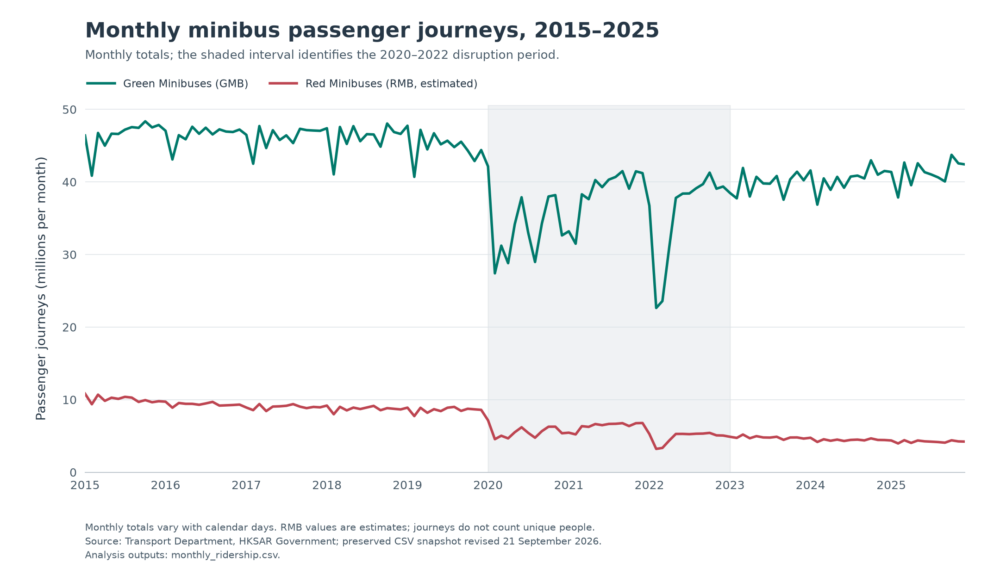
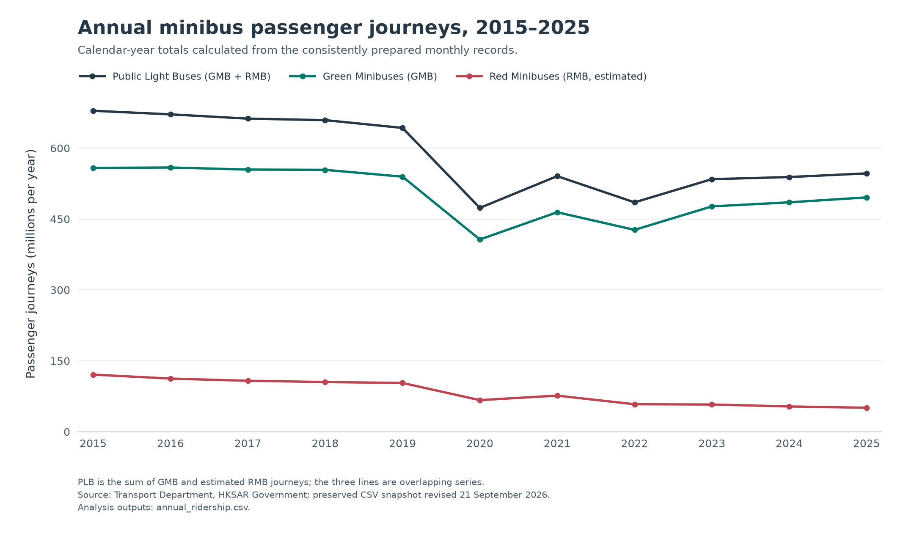
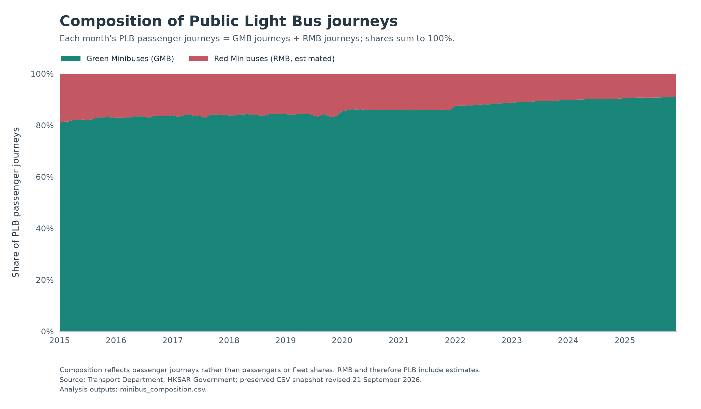
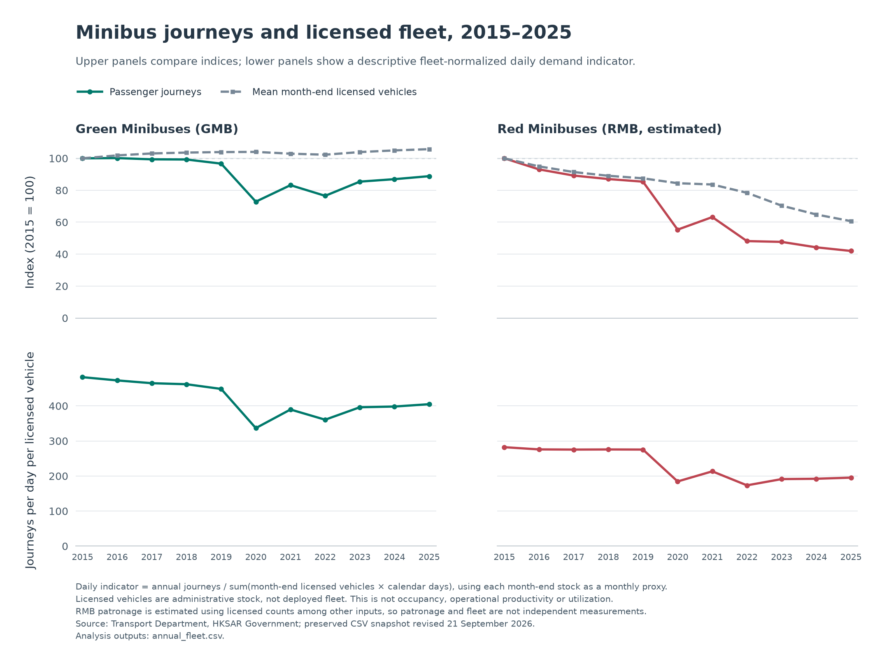
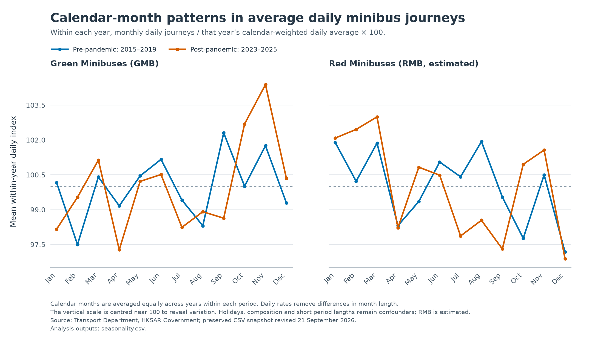

# Hong Kong Minibus Ridership: Exploratory Research Findings

## Executive summary

This study follows published passenger journeys from January 2015 through December 2025 using one internally consistent Transport Department snapshot. The five principal findings are:

1. **PLB journeys are lower over the decade, with a much larger relative reduction in RMB.** PLB fell from 679.001 million to 546.545 million journeys (-19.51%). GMB changed -11.17%; estimated RMB changed -58.00%.
2. **The recent PLB recovery is GMB-driven.** Between 2023 and 2025 GMB rose 4.00% while RMB fell 11.90%. GMB's share of PLB journeys increased from 82.21% in 2015 to 90.72% in 2025.
3. **Recovery differs sharply across modes.** Full-year 2025 was 85.03% of 2019 for PLB, 91.88% for GMB and 49.18% for RMB, compared with 101.99% for MTR and 91.63% for franchised buses.
4. **PLB's relative position weakened within the defined comparison group.** Its combined share moved from 16.99% to 14.32% (-2.67 percentage points). This is a share of GMB + RMB + MTR railway + franchised bus journeys, not all Hong Kong public transport.
5. **Fleet contraction alone does not describe the passenger changes.** December RMB licensed stock fell from 1,141 to 693; GMB stock rose from 3,203 to 3,360. Both categories had lower annual journeys per licensed vehicle-day proxy in 2025 than in 2015.

These findings are descriptive. RMB volumes are estimates; PLB and every comparison-group denominator contain that estimated component. None of the results identifies individual mode switching or a causal mechanism.

## Research questions

The analysis addresses the seven agreed questions: long-term ridership direction; GMB/RMB composition; disruption-period patterns; comparison-group shares; recovery against pre-pandemic benchmarks; calendar-month patterns; and licensed fleet context. The [research plan](../docs/project_plan.md) records their scope and interpretation limits.

## Data sources and analytical scope

The source is the Hong Kong Transport Department's Monthly Traffic and Transport Digest: Table 2.1 monthly passenger journeys, Table 2.1S monthly average daily journeys and Table 2.2 minibus licensed stock/capacity. The preserved files were retrieved on 11 October 2026 and report a dataset revision date of 21 September 2026. All five analytical series contain 132 monthly observations. [Verified inventory](../docs/data_sources.md), [prepared field definitions](../docs/data_dictionary.md).

PLB equals GMB + RMB. MTR equals MTR Lines + Airport Express + Light Rail and includes cross-boundary services in the MTR Lines category. Hong Kong Tramways and MTR buses are excluded. Franchised bus journeys include each contemporaneous franchise once; preparation handles the July 2023 Citybus/NWFB merger. Changing MTR service coverage limits like-for-like network interpretation.

### Annual-reference investigation

The six exceptions compare current monthly sums with older provisional minibus totals. TD permits revisions incorporating updated figures. Current 2024 sums agree with the later December 2025 unflagged publication within rounding tolerance; no inspected note establishes a minibus definition change explaining these exceptions. Publication updates are therefore the best-supported interpretation, but the specific revision reasons remain unresolved. Original observations are retained. [Detailed official evidence and sensitivity investigation](reference_discrepancies.md).

| Older publication | Year | Mode | Reference, thousand | Current sum, thousand | Difference, thousand | Reference flag |
| --- | --- | --- | --- | --- | --- | --- |
| ATD 2025 | 2024 | GMB | 485,356.000 | 485,329.687 | -26.313 | # |
| ATD 2025 | 2024 | RMB | 53,492.000 | 53,489.623 | -2.377 | # |
| ATD 2025 | 2024 | PLB | 538,848.000 | 538,819.310 | -28.690 | # |
| December 2025 | 2025 | GMB | 496,112.000 | 495,802.414 | -309.586 | # |
| December 2025 | 2025 | RMB | 50,773.000 | 50,742.718 | -30.282 | # |
| December 2025 | 2025 | PLB | 546,886.000 | 546,545.132 | -340.868 | # |

Replacing only the 2025 endpoint with the older annual reference changes the decade percentage change by at most 0.055464 percentage points and the 2019 recovery index by at most 0.057370 points. Those differences do not change the main annual conclusions. They are not uncertainty bounds for RMB estimation. The detailed investigation also identifies larger December monthly revisions, so precise monthly comparisons must use a consistent vintage. [Comparison output](../analysis/outputs/annual_reference_comparisons.csv).

## Methodology

Annual flows sum twelve monthly totals in thousands; tables display millions where stated. Year-over-year change compares consecutive complete years or the same calendar month one year earlier. Absolute change is current minus baseline. Recovery is 100 × a mode's annual journeys / its own 2019 annual journeys: 100% denotes the benchmark and values above 100% exceed it. An alternative benchmark uses mean annual journeys in 2015–2018.

Periods are pre-pandemic 2015–2019, disruption 2020–2022 and post-pandemic 2023–2025. Comparisons use mean annual journeys and day-weighted daily rates, rather than contrasting unequal-length period totals. These are timing labels rather than a causal design.

Shares divide each of GMB, RMB, MTR and franchised buses by their combined journeys. Annual shares use annual flow totals, not an average of monthly shares. Combined PLB share is GMB share + RMB share and is not added to the four components again.

Calendar profiles use average daily journeys. To reduce differences in annual demand levels, each monthly daily rate is divided by that year's annual total / actual calendar days and multiplied by 100; profiles then average the same calendar month equally across years within each period. This normalization does not remove within-year trend or changing calendar effects. Population standard deviations and coefficients of variation describe the observed year-specific values, not sampling uncertainty.

The monthly fleet indicator is daily journeys × 1,000 / month-end licensed vehicles. The annual indicator is annual journeys × 1,000 / Σ(month-end licensed vehicles × calendar days), using licensed vehicle-days as a proxy. December stocks and the arithmetic mean of twelve month-end stocks are distinct summaries. The indicator does not measure occupancy, deployment or operational productivity. [Full analytical methods and output dictionary](../docs/analysis_methodology.md).

## Key quantitative findings

### 1. Decade reduction differs substantially between GMB and RMB

| Series | 2015, million | 2019, million | 2025, million | 2015–2025 Δ, million | Decade change | 2025 / 2019 |
| --- | --- | --- | --- | --- | --- | --- |
| Green Minibuses | 558.175 | 539.626 | 495.802 | -62.372 | -11.17% | 91.88% |
| Red Minibuses (estimated) | 120.827 | 103.170 | 50.743 | -70.084 | -58.00% | 49.18% |
| Total PLB (includes estimates) | 679.001 | 642.796 | 546.545 | -132.456 | -19.51% | 85.03% |
| MTR railway services | 1,887.652 | 1,862.830 | 1,899.840 | +12.188 | +0.65% | 101.99% |
| Franchised buses | 1,429.137 | 1,494.283 | 1,369.198 | -59.939 | -4.19% | 91.63% |

PLB lost 132.456 million annual journeys. Estimated RMB accounts for 52.91% of that absolute reduction despite its smaller starting volume. Before the disruption period, PLB had already fallen 5.33% and RMB 14.61% from 2015 to 2019; both declined in each of the four annual transitions. Thus the decade reduction cannot be described solely as a post-2020 phenomenon. It does not establish the causes of either earlier or later reductions. [Endpoints](../analysis/outputs/endpoint_comparison.csv), [trend segments](../analysis/outputs/trend_segments.csv), [change contributions](../analysis/outputs/minibus_change_contributions.csv).





Annual minibus levels and growth are available for every year in [annual_ridership.csv](../analysis/outputs/annual_ridership.csv); first-year growth is unavailable within this window. The following table shows the complete PLB sequence alongside its components.

| Year | GMB, million | RMB, million (estimated) | PLB, million | PLB annual Δ, million | PLB YoY |
| --- | --- | --- | --- | --- | --- |
| 2015 | 558.175 | 120.827 | 679.001 | — | — |
| 2016 | 559.013 | 112.459 | 671.472 | -7.530 | -1.11% |
| 2017 | 554.628 | 107.780 | 662.408 | -9.064 | -1.35% |
| 2018 | 554.059 | 105.151 | 659.210 | -3.198 | -0.48% |
| 2019 | 539.626 | 103.170 | 642.796 | -16.414 | -2.49% |
| 2020 | 406.698 | 66.863 | 473.561 | -169.235 | -26.33% |
| 2021 | 464.387 | 76.371 | 540.759 | +67.198 | +14.19% |
| 2022 | 427.081 | 58.204 | 485.285 | -55.474 | -10.26% |
| 2023 | 476.749 | 57.595 | 534.344 | +49.060 | +10.11% |
| 2024 | 485.330 | 53.490 | 538.819 | +4.475 | +0.84% |
| 2025 | 495.802 | 50.743 | 546.545 | +7.726 | +1.43% |

### 2. Recent growth is GMB-driven and composition continues to shift

GMB's PLB journey share rose from 82.21% to 90.72% (+8.51 percentage points). Estimated RMB's share moved from 17.79% to 9.28%. From 2023 to 2025, GMB added 19.053 million journeys while RMB lost 6.853 million; PLB gained 12.201 million (+2.28%).

GMB increased in every annual transition from 2022 to 2025; RMB decreased in all three. In 2025 alone, GMB grew 2.16%, RMB changed -5.14%, and PLB grew 1.43%. This supports a description of partial, uneven recovery rather than common stabilization across minibus categories. GMB accounts for more than the net PLB increase because RMB offsets part of its gain; change contributions are not market shares. Composition alone cannot show that the same passengers moved between services. [Annual composition](../analysis/outputs/annual_minibus_composition.csv), [segment changes](../analysis/outputs/trend_segments.csv).



### 3. Recovery remains incomplete for minibuses and depends on the benchmark

With 2019 fixed at 100%, PLB reaches 85.03% in 2025, compared with MTR's 101.99%. Estimated RMB remains at 49.18% of its benchmark. MTR exceeding its own 2019 journeys does not prove substitution from minibuses: service coverage and other demand conditions also differ. [Recovery output](../analysis/outputs/recovery_2019.csv).


The 2015–2018 mean is a useful sensitivity benchmark because 2019 is not assumed to represent an undisturbed or fixed demand level. The alternative changes the level of recovery; it does not erase the GMB/RMB difference.

| Series | 2025 / 2019 | 2025 / mean annual 2015–2018 |
| --- | --- | --- |
| Green Minibuses | 91.88% | 89.10% |
| Red Minibuses (estimated) | 49.18% | 45.49% |
| Total PLB (includes estimates) | 85.03% | 81.82% |
| MTR railway services | 101.99% | 98.33% |
| Franchised buses | 91.63% | 94.34% |

Period comparisons below use mean annual journeys (million), so five-year and three-year groups are comparable in scale. Day-weighted daily rates are also saved in [period_summary.csv](../analysis/outputs/period_summary.csv).

| Series | 2015–2019 mean | 2020–2022 mean | 2023–2025 mean |
| --- | --- | --- | --- |
| Green Minibuses | 553.100 | 432.722 | 485.960 |
| Red Minibuses (estimated) | 109.877 | 67.146 | 53.943 |
| Total PLB (includes estimates) | 662.978 | 499.868 | 539.903 |
| MTR railway services | 1,918.321 | 1,434.854 | 1,877.823 |
| Franchised buses | 1,459.884 | 1,170.603 | 1,363.063 |

Monthly totals and daily rates identify different trough months for several modes. Short February totals must not be treated as directly equivalent to daily demand. These are the minima observed within the complete study window; their timing coincides with the disruption period, without isolating a causal effect.

| Series | Lowest monthly total | Million journeys | Lowest daily rate month | Thousand journeys/day |
| --- | --- | --- | --- | --- |
| Green Minibuses | 2022-02 | 22.635 | 2022-03 | 760.750 |
| Red Minibuses (estimated) | 2022-02 | 3.216 | 2022-03 | 108.001 |
| Total PLB (includes estimates) | 2022-02 | 25.851 | 2022-03 | 868.751 |
| MTR railway services | 2022-02 | 69.508 | 2022-03 | 2,321.606 |
| Franchised buses | 2022-03 | 57.666 | 2022-03 | 1,860.210 |

[Trough values and same-month 2019 comparisons](../analysis/outputs/monthly_minima.csv).

### 4. Public light buses lost comparison-group share

Combined PLB share fell from 16.99% in 2015 to 14.32% in 2025 (-2.67 percentage points). RMB's contribution moved from 3.02% to 1.33%; GMB's from 13.97% to 12.99%. MTR's share rose from 47.24% to 49.79%. Relative shares reflect changes in both numerator and denominator, not just minibus demand. [Annual shares](../analysis/outputs/annual_market_share.csv), [monthly shares](../analysis/outputs/monthly_market_share.csv).

| Nonoverlapping component | 2015 share | 2019 share | 2025 share |
| --- | --- | --- | --- |
| Green Minibuses | 13.97% | 13.49% | 12.99% |
| Red Minibuses (estimated) | 3.02% | 2.58% | 1.33% |
| MTR railway services | 47.24% | 46.57% | 49.79% |
| Franchised buses | 35.77% | 37.36% | 35.88% |


The four components sum to 100%. PLB is their GMB/RMB subtotal, not a fifth additive share. Every denominator includes estimated RMB, even when a displayed numerator is reported.

### 5. Licensed fleet context reinforces the need to separate categories

| Series | Dec 2015 vehicles | Dec 2025 vehicles | Stock change | 2015 journeys/vehicle-day proxy | 2025 proxy | Proxy change |
| --- | --- | --- | --- | --- | --- | --- |
| Green Minibuses | 3,203 | 3,360 | +4.90% | 481.96 | 404.86 | -16.00% |
| Red Minibuses (estimated) | 1,141 | 693 | -39.26% | 282.22 | 195.39 | -30.77% |

GMB's licensed stock increased while its decade passenger total decreased; estimated RMB journeys fell faster than its licensed stock. Both fleet-normalized indicators were lower than their 2015 benchmarks. That is descriptive stock context, not evidence that operating vehicles became less productive. Month-end stocks do not reveal daily deployment, and RMB estimation uses licensed fleet information, creating a partly mechanical relationship. Comparable RMB mileage is unavailable. [Annual fleet summaries](../analysis/outputs/annual_fleet.csv), [monthly normalized indicators](../analysis/outputs/fleet_normalized.csv).



## Calendar-month patterns and statistical interpretation

The normalized daily profiles show moderate calendar-month variation outside the disruption period. They describe observed averages, with no claim of statistical significance or a stable recurring seasonal mechanism. Raw monthly means, daily means, population standard deviations and coefficients of variation are saved for inspection.

| Series | Period | Peak month | Peak index | Trough month | Trough index | Range, index points |
| --- | --- | --- | --- | --- | --- | --- |
| Green Minibuses | 2015–2019 | Sep | 102.30 | Feb | 97.50 | 4.81 |
| Green Minibuses | 2023–2025 | Nov | 104.38 | Apr | 97.27 | 7.11 |
| Red Minibuses (estimated) | 2015–2019 | Aug | 101.93 | Dec | 97.18 | 4.75 |
| Red Minibuses (estimated) | 2023–2025 | Mar | 102.99 | Dec | 96.89 | 6.10 |

Index 100 is the corresponding year's annual day-weighted daily level. The pre-period has five values per calendar month and the post-period three; these are small collections of years, not independent random observations. Normalization removes annual level differences but retains within-year growth/decline, movable calendar effects and service changes. In particular, RMB's ongoing decline can influence a profile whose later months are lower. The broader disruption-period profile combines sharp demand interruptions with calendar variation and must not be interpreted as ordinary seasonality. [Profiles and dispersion](../analysis/outputs/seasonality.csv), [profile ranges](../analysis/outputs/seasonality_ranges.csv).



## Industry and transport implications

The aggregate evidence describes an increasingly GMB-dominated minibus industry. GMB's recent growth and RMB's continued reduction deserve separate treatment in transport planning and industry discussion. A combined PLB headline conceals that difference. The smaller PLB comparison-group share and incomplete recovery indicate persistent departures from historical benchmarks, while MTR's different trajectory shows that the result is mode-specific rather than a uniform pattern across the comparison group.

These patterns could reflect changes in route coverage, service supply, fares, demographics, visitor travel or reporting/estimation methods. This dataset does not measure their individual effects. Establishing structural causes would require additional verified evidence and an appropriate research design; the descriptive patterns alone cannot attribute losses to competition or permanent passenger switching.

## Reproducibility and analytical checks

The analysis run passed **54 checks**, recorded **3 limitations**, and had **0 failed checks**. The six analytical SQL queries agree with independent Pandas calculations for annual aggregation/growth, same-month growth, annual/monthly shares, recovery and fleet normalization. Checks also verify annual/monthly PLB identity, 100% share totals, calendar weighting, normalized baselines, CSV round-trips and unchanged Phase 1/2 input bytes. [Machine-readable analysis summary](../analysis/outputs/analysis_summary.json), [SQL query documentation](../sql/analysis/README.md).

Every numeric statement in this report is generated from the linked tables by [analysis_report.py](../src/hk_minibus/analysis_report.py). Calculations are in [analysis.py](../src/hk_minibus/analysis.py); [analysis_pipeline.py](../src/hk_minibus/analysis_pipeline.py) verifies inputs and cross-checks the independent SQL outputs. Values are rounded only for display. The discrepancy investigation additionally records explicitly transcribed official reference evidence.

From the repository root, after installing requirements:

```powershell
.\.venv\Scripts\python.exe scripts\analyze_data.py
.\.venv\Scripts\python.exe -m pytest -q --basetemp analysis/.pytest-tmp-run -p no:cacheprovider
```

## Data limitations

- RMB estimates have no published confidence intervals or complete parameter history. The source-vintage sensitivity exercise is not a measurement-error estimate.
- Journeys are aggregate patronage, not unique people. Shares describe only the chosen comparison group.
- The current snapshot is internally consistent, but earlier provisional publications differ. Detailed revision reasons remain unresolved.
- MTR services changed across the study; the bus merger changes component labels, while preparation maintains the contemporaneous total boundary.
- Period comparisons and recovery ratios have no causal identification; 2019 and earlier mean baselines give different answers.
- Calendar profiles use few years and retain within-year trend and changing calendar effects. No hypothesis test or inferential interval is asserted.
- Licensed vehicles and carrying capacity do not measure operating deployment or occupancy; RMB mileage is unsupported.

## Conclusion

Published PLB journeys decreased over the decade, while the subsequent recovery is concentrated in GMB and the estimated RMB series remains substantially lower. The shift in composition, comparison-group share and licensed fleet context supports a differentiated historical account of the industry. It establishes what changed in these published aggregates, while leaving the underlying causes and estimation uncertainty open.
